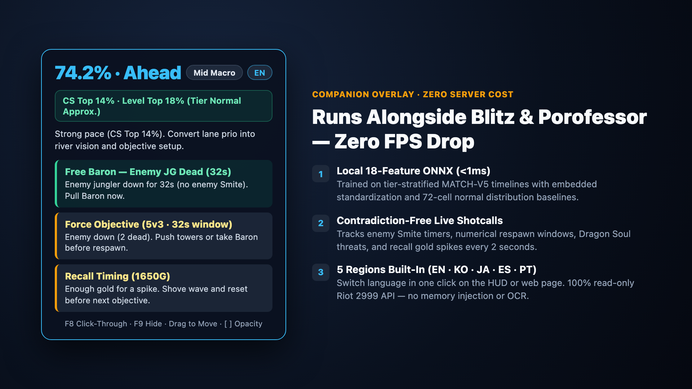
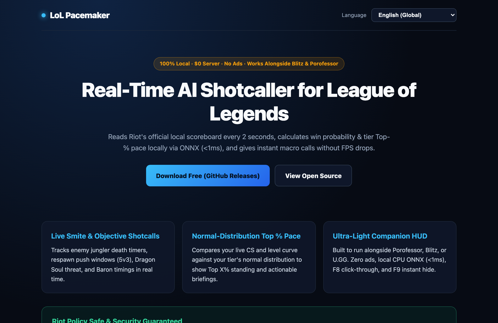

# LoL Pacemaker

**Zero-server, ad-free, real-time AI shotcaller & win-rate companion for League of Legends.**

Built to run **alongside** pre/post-game tools like Blitz, Porofessor, or U.GG — without overlapping their UI or hurting your FPS.



---

## Why LoL Pacemaker?

Existing League apps excel at **pre-game** (runes, bans, matchups) and **post-game** stats. What's missing is an ultra-light **in-game macro shotcaller** that reads the live board every 2 seconds and tells you what actually matters *right now*:

- **Live Smite & Respawn-Window Shotcalls**: Instant **"Free Baron — Enemy JG Dead (32s)"** when enemy Smite is off the map, **"Do NOT 50/50"** when your jungler is down, and respawn-timed push calls (`5v3 · 32s window`).
- **Normal-Distribution Top % Pace**: Compares your live CS/min, level, and kill participation against 72-cell tier/minute/role normal distributions (`distribution_stats.json`) to show your **Top X% standing** and actionable briefings.
- **18-Feature Local ONNX (`<1ms`, $0 Server)**: Runs a verified ONNX model locally on CPU (`onnxruntime`) trained on tier-stratified Riot `MATCH-V5` timelines (`LogLoss 0.3969`, `AUC 0.9275`, ONNX parity `1.19e-7`). Zero cloud latency, zero ads, and zero gameplay data leaves your PC.
- **Multi-Language (`EN · KO · JA · ES · PT`)**: Switch languages in one click on the HUD or on the download page. New regions only require adding a single JSON pack in `locales/`.
- **Companion UX**: Compact borderless transparent window (`~300px`), drag to move, `[` / `]` opacity, **`F8` click-through**, **`F9` instant hide**.

---

## Multi-Language Download Page (`web/index.html`)

Automatically detects the visitor's browser language (`en`, `ko`, `ja`, `es`, `pt`) and supports instant switching with zero external trackers or ads. Ready for $0 static hosting on Cloudflare Pages or GitHub Pages.



---

## Riot Policy & Security Guarantee

- **Read-Only Official Local API**: Uses only `https://127.0.0.1:2999/liveclientdata/allgamedata` (public Tab scoreboard & events).
- **No Unfair Advantage**: Never reads hidden enemy gold, wards, fog-of-war positions, or enemy cooldowns.
- **No Memory Injection / No OCR**: Standalone companion overlay window with `127.0.0.1` loopback binding, `textContent`-only DOM rendering, and CSP headers.
- **Verified Serverless Updates**: Optional model updates from GitHub Releases enforce **HTTPS-only** transport, **`SHA-256` checksum verification**, ONNX schema validation, and atomic swap with automatic fallback to the bundled model.

---

## Project Structure

```
lol-pacemaker/
├── AGENTS.md                 # Architecture, ML pipeline & security specification
├── assets/                   # Bundled 18-feature ONNX model, 72-cell stats & legacy fallback
├── locales/                  # 5 language packs (en, ko, ja, es, pt — 100% key parity tested)
├── ml/                       # Offline tier-stratified MATCH-V5 collector & ONNX trainer
├── src/                      # Local ONNX predictor, shotcaller engine, Tk HUD, SHA-256 updater
├── web/index.html            # 5-language static landing & download page
├── scripts/                  # PyInstaller Windows/macOS builder & checksums.sha256 generator
└── tests/                    # 56 automated tests (i18n, ONNX parity, updater tamper, HUD state)
```

---

## Quick Start (From Source)

```bash
uv sync --all-groups
uv run python -m pytest -v
uv run python -m src.main
```

Or download the pre-built **Windows / macOS** binary from [GitHub Releases](https://github.com/wpalswpa/lol-pacemaker/releases).
